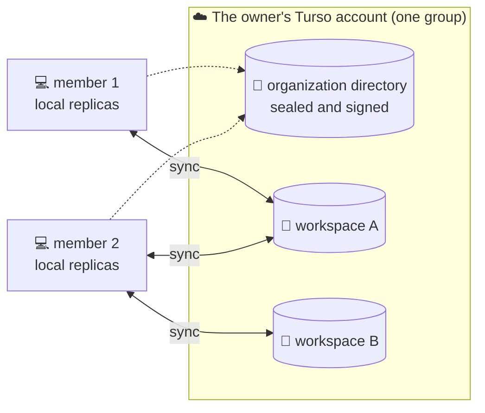

<div align="center">

# 🏠 rentable

**A desktop tracker for rent payments that works offline and keeps your data on your own account.**

[](https://github.com/saud-alnasser/rentable/actions/workflows/integration.yml)
[](https://github.com/saud-alnasser/rentable/actions/workflows/release.yml)
[](https://github.com/saud-alnasser/rentable/releases)


[✨ Highlights](#-highlights) · [🧭 How it works](#-how-it-works) · [🚀 Quick start](#-quick-start) · [🧰 Commands](#-commands) · [🗺️ Repository map](#%EF%B8%8F-repository-map) · [🤝 Contributing](#-contributing)

</div>

---

## ✨ Highlights

- 📴 **Offline first.** Signing in, reading and writing all work with no network. Changes sync
  whenever one comes back.
- 🔐 **Your data, your account.** An organization lives on a Turso account its owner holds.
  There is no service of ours in between.
- 🔑 **Nothing to paste.** The owner grants consent once, in the browser, and the app creates
  everything it needs.
- 👥 **Built for teams.** Every member's machine keeps a replica of the workspaces they were
  granted, and syncs with them directly.
- 🖥️ **Runs everywhere Tauri does.** Installers are built for Linux, Windows, and macOS on both
  Intel and Apple Silicon.

## 🧭 How it works



An organization is one Turso database for its own directory, sealed and signed, plus one
database per workspace. Each member's machine holds a local replica of the workspaces they were
granted and talks to the owner's account directly.

> [!NOTE]
> The consent is scoped to **one Turso group**, and one group holds one organization. Pick a
> group that already holds one and the machine connects to it instead of making a second.

## 🚀 Quick start

### 📋 Prerequisites

| Need                   | Why                                                                                                   |
| ---------------------- | ----------------------------------------------------------------------------------------------------- |
| 🟩 **Node 24**         | the frontend and the tooling                                                                          |
| 📦 **pnpm 12**         | the package manager. `engine-strict` is on, so npm and yarn will refuse                               |
| 🦀 **Rust**            | the desktop shell, plus [Tauri 2's platform prerequisites](https://tauri.app/start/prerequisites/)    |
| ☁️ **A Turso account** | where the organization is set up. The app asks for consent on its first run and creates what it needs |
| 🌐 **A network**       | for the first run only. Every launch after that opens the replica on this machine                     |

### 🛠️ Setup

```sh
pnpm install
cp apps/desktop/.env.example apps/desktop/.env
```

Each variable in the `.env` has a comment saying what it is for.

> [!TIP]
> Nothing in the `.env` is needed to sign in. A person's password opens their place in an
> organization on this machine, with or without a network.

### ▶️ Run it

```sh
pnpm dev
```

That starts the desktop app with its Rust side. On first launch it walks you through granting
consent and creating or connecting an organization.

## 🧰 Commands

### 🏃 Running

| Command                            | What it runs                                           |
| ---------------------------------- | ------------------------------------------------------ |
| `pnpm dev`                         | the desktop app, Rust side included                    |
| `pnpm dev:desktop`                 | the same                                               |
| `pnpm dev:web`                     | the frontend alone on port 1420, with no Rust under it |
| `pnpm prototype /contracts?create` | the desktop app, opened on one route                   |

> [!WARNING]
> `pnpm dev:web` is for UI work only. With no Rust side under it, anything that reaches the
> database or a Tauri command fails, and the sign-in wall never clears.

### 📦 Building

| Command              | What it builds                                                  |
| -------------------- | --------------------------------------------------------------- |
| `pnpm build`         | the installers                                                  |
| `pnpm build:desktop` | the same. Slow: a release-profile Rust build, then every bundle |
| `pnpm build:web`     | the frontend bundle only. Fast, and what a pull request proves  |

### ✅ Checking

| Command          | What it checks                                        |
| ---------------- | ----------------------------------------------------- |
| `pnpm check`     | each package's typecheck, then prettier over the tree |
| `pnpm lint`      | prettier and eslint                                   |
| `pnpm test`      | the TypeScript tests, through turbo                   |
| `pnpm test:rust` | the Rust tests                                        |

<details>
<summary>🔬 <b>About CI and the live Turso tests</b></summary>

<br/>

CI runs all of the checks above as one required check called `integration`. It also runs
`pnpm build:web` and compiles the Rust binary in release profile. It never packages installers;
that happens on `main`, in the release workflow.

Some Rust tests reach a live Turso account. They are ignored by default, and run only with both
`RENTABLE_LIVE_TURSO=1` and `--ignored`. Each one creates and removes its own database, and
`apps/desktop/.env.example` names what they read.

</details>

## 🗺️ Repository map

```text
rentable/
├── 🖥️  apps/desktop                    the application: a Tauri 2 shell in Rust around SvelteKit 2 and Svelte 5
├── 📦  packages/
│   ├── 🎨  design                      the design system the frontend is drawn from
│   ├── 🗄️  workspace-migrations        the SQL a workspace database is built from
│   ├── 🛡️  workspace-permission        what a member may do to a workspace, named the same on both sides
│   └── 🧪  testing                     the test scaffolding the app and the design package share
└── 📐  .aep/                           how work is done here. .aep/protocol.md is the way in
```

## 🤝 Contributing

Start with [`.aep/protocol.md`](.aep/protocol.md). It is the bootstrap for how changes are
specified, built, reviewed and landed here, and [`AGENTS.md`](AGENTS.md) points every agent
runtime to it. None of it is restated here, because a summary in a README becomes a second copy
of the rules, and that copy is the one that drifts.

Found a bug or have an idea? 🐛 [Open an issue](https://github.com/saud-alnasser/rentable/issues/new/choose).
